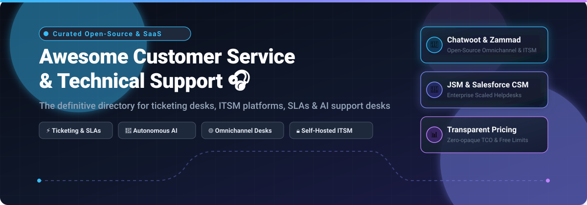

# 🎧 Awesome Customer Service & Technical Support

  

  
  
  
  
  
  
  

> 🌟 **The definitive, community-curated directory of top Customer Service, Helpdesk, ITSM, and Technical Support software.** Featuring transparent SaaS pricing tiers, free forever limits, and self-hosted open-source GitHub projects.

---

## 📌 Table of Contents

- [📈 Sector Overview & Market Dynamics](#-sector-overview--market-dynamics)
- [☁️ SaaS / Hosted Support Platforms](#️-saas--hosted-support-platforms)
- [💻 Open-Source GitHub Projects](#-open-source-github-projects)
- [🤝 How to Contribute](#-how-to-contribute)
- [💖 Support & Sponsorship](#-support--sponsorship)
- [⚖️ Disclaimer & Evaluation Guide](#️-disclaimer--evaluation-guide)
- [⭐ Star History](#-star-history)

---

## 📈 Sector Overview & Market Dynamics

The global customer service and technical support software market is valued at approximately **$11B–$15B** (projected to exceed **$26B–$40B+** by the early 2030s at an ~8–12% CAGR, scaling beyond **$50B+** when encompassing cloud contact center infrastructure and unified ITSM suites). 

Market concentration follows a two-tier paradigm:
1. **Enterprise Tier (Moderately Concentrated):** Large enterprises gravitate toward dominant ecosystem anchors—notably Salesforce Service Cloud, ServiceNow CSM, and Jira Service Management—where deep CRM, ITSM, and CMDB workflow integrations create high vendor lock-in.
2. **SMB, Mid-Market & Niche Support (Highly Fragmented):** Hundreds of point solutions and self-hosted open-source helpdesks compete vigorously on pricing transparency, rapid onboarding, dedicated vertical workflows, and autonomous AI-first resolution models.

---

## ☁️ SaaS / Hosted Support Platforms

*Sorted by Company Valuation / Revenue (descending).*

| Product | Company Valuation / Revenue | Starting Pricing | Free Tier / Trial Limits | Key Focus & Best For |
| :--- | :--- | :--- | :--- | :--- |
| **[Salesforce Service Cloud](https://www.salesforce.com/)** | **~$190B Market Cap** (~$41.5B FY26 Revenue) | **$25/user/month** (Starter Suite, billed annually) | **30-day free trial** (full Starter Suite functionality; no credit card required) | Large enterprises needing deep CRM-connected case routing & Einstein AI |
| **[ServiceNow CSM](https://www.servicenow.com/)** | **~$110B–$150B Market Cap** (~$13B+ TTM Revenue) | **~$100–$150/fulfiller/month** (entry tier; min annual spend ~$40k) | **No perpetual free tier**; free Developer PDI (1 active instance for testing, subject to reclamation on inactivity) or 14–30 day sales trial | Enterprises demanding deep ITSM, CMDB, and cross-departmental workflow integration |
| **[Jira Service Management](https://www.atlassian.com/software/jira/service-management)** | **~$50B Market Cap** (~$6.57B FY26 Revenue, Atlassian) | **$17.65/agent/month** (or ~$21,000/year for 100 agents; Standard) | **Free forever plan**: Up to **3 agents**, unlimited customers, 2 GB storage, core ITSM features | Dev & engineering-aligned support teams needing native Jira/Atlassian integration |
| **[Zoho Desk](https://www.zoho.com/desk/)** | **~$11B–$12.5B Valuation est.** (~$1.4B–$1.5B Revenue, Zoho Corp) | **$7/agent/month** (Express tier, billed annually) | **Free forever plan**: Up to **3 agents**, email ticketing, customer management, private knowledge base | SMBs & cost-conscious teams seeking robust ticketing with a genuine free plan |
| **[Zendesk Support](https://www.zendesk.com/)** | **$10.2B Acquisition Valuation** (~$2B ARR, PE-owned) | **$19/agent/month** (Support Team, billed annually) | **14-day free trial** (full access to Zendesk Suite features; no credit card required) | Organizations prioritizing mature omnichannel ticketing, macros, and integrations |
| **[Freshdesk](https://www.freshworks.com/freshdesk/)** | **~$3.9B Market Cap** (~$900M TTM Revenue, Freshworks) | **$15/agent/month** (Growth tier, billed annually; $19 monthly) | **14-day free trial** (up to 10 agents on Pro tier; no credit card required) | Mid-market teams wanting modern omnichannel ticketing with Freddy AI |
| **[Intercom](https://www.intercom.com/)** | **$3.6B Acquisition Valuation** (~$400M ARR, Salesforce-owned) | **$0.99/seat/month** (Essential) + **$0.99 per Fin AI resolution** | **14-day free trial** (full access to Fin AI Agent, inbox & help center; optional 7-day extension) | Fast-paced tech companies and SaaS teams wanting AI-first, outcome-based customer resolution |
| **[HappyFox](https://www.happyfox.com/)** | **~$20M ARR** (Bootstrapped, Private) | **$24/agent/month** (Basic plan, billed annually; max 5 agents) | **14-day free trial** (unlimited access to help desk features; no credit card required) | Mid-size teams wanting structured workflow automation without enterprise overhead |
| **[Kayako](https://kayako.com/)** | **~$10M–$15M ARR est.** (ESW Capital / Trilogy) | **$1.00 per AI resolution** (or ~$79/agent/month for Kayako One) | **14-day free trial** (full access to AI automation & support inbox; no credit card required) | Teams prioritizing pure autonomous resolution pricing with zero human escalation charges |

*(Note: Atlassian Support is Atlassian's internal customer service delivery organization for its own software suite rather than a standalone commercial ticketing tool; for Atlassian's service desk software, refer to Jira Service Management above.)*

---

## 💻 Open-Source GitHub Projects

*Self-hosted helpdesks, ticketing systems, and ITSM solutions sorted by GitHub Star Count (descending).*

### 1. **[Chatwoot](https://github.com/chatwoot/chatwoot)** 
* **Description:** Open-source omnichannel customer engagement platform alternative to Intercom, Zendesk, and Drift.
* **License:** MIT License
* **Tech Stack:** Ruby on Rails, Vue.js, PostgreSQL, Redis
* **Highlights:** Live chat widget, omnichannel unified inbox (Email, WhatsApp, Twitter/X, Facebook, Instagram, SMS, Telegram), multi-brand support, auto-assignment workflows, and custom webhooks.
* **Best For:** Modern SaaS companies and digital businesses needing omnichannel live chat and shared inbox capabilities.

---

### 2. **[UVdesk Community Edition](https://github.com/uvdesk/community-skeleton)** 
* **Description:** Fully extensible open-source helpdesk system built for standard and enterprise PHP hosting environments.
* **License:** Open Software License 3.0 (OSL-3.0)
* **Tech Stack:** PHP (Symfony framework), MySQL
* **Highlights:** Unlimited agents, teams, groups, and mailboxes; customer self-service portal; knowledge base and FAQ publisher; customizable workflow triggers and email parsing.
* **Best For:** Organizations with existing LAMP/LEMP infrastructure wanting modular, extensible PHP ticketing with unlimited support agents.

---

### 3. **[GLPI Project](https://github.com/glpi-project/glpi)** 
* **Description:** Enterprise open-source ServiceDesk, Helpdesk, and IT Asset Management (ITSM/ITAM) platform.
* **License:** GPL-3.0 License
* **Tech Stack:** PHP, MariaDB / MySQL
* **Highlights:** End-to-end ITIL-aligned service management, incident & problem tracking, full hardware/software inventory (CMDB), SLA escalations, financial contract tracking, and user self-service portals.
* **Best For:** Corporate IT departments, universities, and institutions needing deeply integrated ITSM and IT Asset Management.

---

### 4. **[Zammad](https://github.com/zammad/zammad)** 
* **Description:** Web-based, open-source user support and customer ticketing system with modern real-time interactions.
* **License:** GNU AGPLv3
* **Tech Stack:** Ruby on Rails, PostgreSQL/MySQL, Elasticsearch
* **Highlights:** Real-time multi-channel support (Email, Chat, Telephone, Social Media), auto-save draft states, collision detection preventing two agents answering the same ticket, granular SLA escalation engine, and LDAP/OAuth authentication.
* **Best For:** Fast-moving support teams seeking a polished, real-time UI alternative to Zendesk or Freshdesk.

---

### 5. **[FreeScout](https://github.com/freescout-help-desk/freescout)** 
* **Description:** Lightweight, open-source shared email inbox and helpdesk that serves as a direct self-hosted drop-in alternative to Help Scout and Zendesk.
* **License:** GNU AGPLv3
* **Tech Stack:** PHP 8+ (Laravel Framework), MySQL/MariaDB
* **Highlights:** 100% mobile-friendly responsive UI, multi-mailbox support, push notifications, auto-reply rules, zero seat fees, and extensive plugin marketplace (LDAP, Telegram, WhatsApp, satisfaction surveys).
* **Best For:** Small-to-medium teams wanting a clean, lightweight shared inbox on shared or VPS hosting.

---

### 6. **[osTicket](https://github.com/osTicket/osTicket)** 
* **Description:** Battle-tested, widely-deployed open-source customer support ticketing platform.
* **License:** GPL-2.0 License
* **Tech Stack:** PHP, MySQL/MariaDB
* **Highlights:** Inbound email ticket routing, auto-response rules, ticket transfer across departments, custom form fields, internal notes, collision prevention, and SLA support.
* **Best For:** Budget-conscious teams and small organizations needing a reliable, traditional web-and-email ticket desk with low hardware requirements.

---

### 7. **[Frappe Helpdesk](https://github.com/frappe/helpdesk)** 
* **Description:** Modern open-source helpdesk and customer ticketing system built on the extensible Frappe Framework.
* **License:** GNU AGPLv3
* **Tech Stack:** Python, Vue.js 3, MariaDB, Redis, Tailwind CSS
* **Highlights:** Native customer sync with ERPNext; unlimited support agents without per-seat licensing fees; robust SLA policies with business hours rules; customizable intake forms; agent workload analytics.
* **Best For:** Organizations running Frappe/ERPNext or teams requiring a modern Python/Vue-based ticketing suite.

---

### 8. **[Helpy](https://github.com/helpyio/helpy)** 
* **Description:** Modern, mobile-first open-source customer service helpdesk and customer communication app.
* **License:** MIT License
* **Tech Stack:** Ruby on Rails, PostgreSQL
* **Highlights:** Integrated multi-lingual knowledge base, customer community forums, private internal support ticketing, and clean multi-channel intake.
* **Best For:** Teams wanting an integrated self-service knowledge base, forum, and email helpdesk under an MIT license.

---

### 9. **[Trudesk](https://github.com/polonel/trudesk)** 
* **Description:** Open-source helpdesk and ticket management software designed with a clean, responsive single-page architecture.
* **License:** Apache-2.0 License
* **Tech Stack:** Node.js, Express, MongoDB, Elasticsearch
* **Highlights:** Real-time push updates via WebSockets, ticket assignment queues, live customer chat, custom dashboard reporting, and dynamic ticket tagging.
* **Best For:** JavaScript/Node.js-centric engineering teams looking for a lightweight document-store ticketing backend.

---

### 10. **[Request Tracker (RT)](https://github.com/bestpractical/rt)** 
* **Description:** Industrial-grade open-source ticket tracking platform renowned for granular security and complex ticket workflows.
* **License:** GPL-2.0 License
* **Tech Stack:** Perl, PostgreSQL / MySQL / Oracle
* **Highlights:** Granular per-queue permissions, asset management tracking, rich REST 2.0 API, GnuPG/S-MIME cryptographic email support, and immutable ticket audit histories.
* **Best For:** Network operations centers (NOCs), IT infrastructure teams, and security response teams (CERT/CSIRT) needing enterprise-grade compliance and auditability.

---

### 11. **[OTOBO](https://github.com/RotherOSS/otobo)** 
* **Description:** Actively maintained open-source IT Service Management (ITSM) and ticketing platform (fork of (OTRS)® Community Edition).
* **License:** GPL-3.0 License
* **Tech Stack:** Perl, Apache/Nginx, MariaDB / MySQL / PostgreSQL / Oracle
* **Highlights:** Free ITSM modules (Incident, Problem, Change Management, CMDB), modern responsive agent interface, OpenID Connect / SAML / LDAP authentication, and full customer self-service portal.
* **Best For:** IT departments and service providers transitioning from legacy OTRS desiring full ITSM compliance without commercial license fees.

---

## 🤝 How to Contribute

Contributions are welcome and greatly appreciated! 🚀

1. 🍴 **Fork** the repository.
2. 🌿 **Create a new branch**: `git checkout -b feature/add-new-platform`
3. ✏️ **Add your entry** under the appropriate section in `README.md` following the existing format:
   - Name and link
   - GitHub stars badge (with `style=social&color=white`) linking to its stargazers page
   - Description, License, Tech stack, and operational highlights
4. 📝 **Commit your changes**: `git commit -m "Add NewTool to open-source support list"`
5. 🚀 **Push to your branch**: `git push origin feature/add-new-platform`
6. 📬 **Submit a Pull Request** with a brief summary of the project.

---

## 💖 Support & Sponsorship

If you find this curated directory helpful for evaluating your technical support and customer service infrastructure:

- ⭐ **Star this repository** to help others discover it!
- 🍴 **Fork and share** it with your engineering and IT support leads.
- ☕ **Buy me a coffee / Sponsor this project:** Support ongoing research and maintenance via the **[GitHub Sponsors Dashboard](https://github.com/sponsors/ishandutta2007)**!

Your support ensures this list remains updated with the latest SaaS pricing shifts, open-source releases, and architectural tradeoffs!

---

## ⚖️ Disclaimer & Evaluation Guide

* This directory is **community-curated** for educational, architectural, and procurement evaluation purposes—not an explicit endorsement.
* **Data Privacy & Compliance:** Technical customer support desks frequently process sensitive customer data and PII. Always ensure your deployment aligns with GDPR, HIPAA, SOC 2, and CCPA standards.
* **ITSM vs. Omnichannel vs. AI Resolution vs. Self-Hosted Helpdesk:**
  - **ITSM-Integrated (Jira Service Management, GLPI, OTOBO):** Connects IT infrastructure, CMDB assets, and dev-to-support escalations.
  - **Omnichannel Support (Zendesk, Freshdesk, Zoho Desk, Chatwoot, Zammad):** Unifies communication across email, live chat, social media, voice, and messaging apps.
  - **Autonomous AI Resolution (Intercom Fin, Kayako):** Focuses on end-to-end outcome resolution metrics ($0.99–$1.00 per autonomous resolution) rather than traditional per-agent seat models.
  - **Self-Hosted Control (Chatwoot, Zammad, FreeScout, Frappe Helpdesk, osTicket, RT):** Full infrastructure sovereignty, zero vendor lock-in, and zero incremental per-agent licensing fees.

---

## ⭐ Star History

---

  <b>Made with ❤️ for support leads, IT operations teams, and DevOps engineers worldwide.</b> 
  <i>Let's make Customer Service &amp; Technical Support more transparent, accessible, and community-driven.</i>

